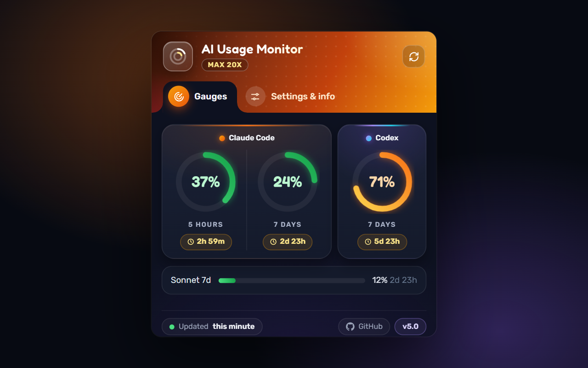
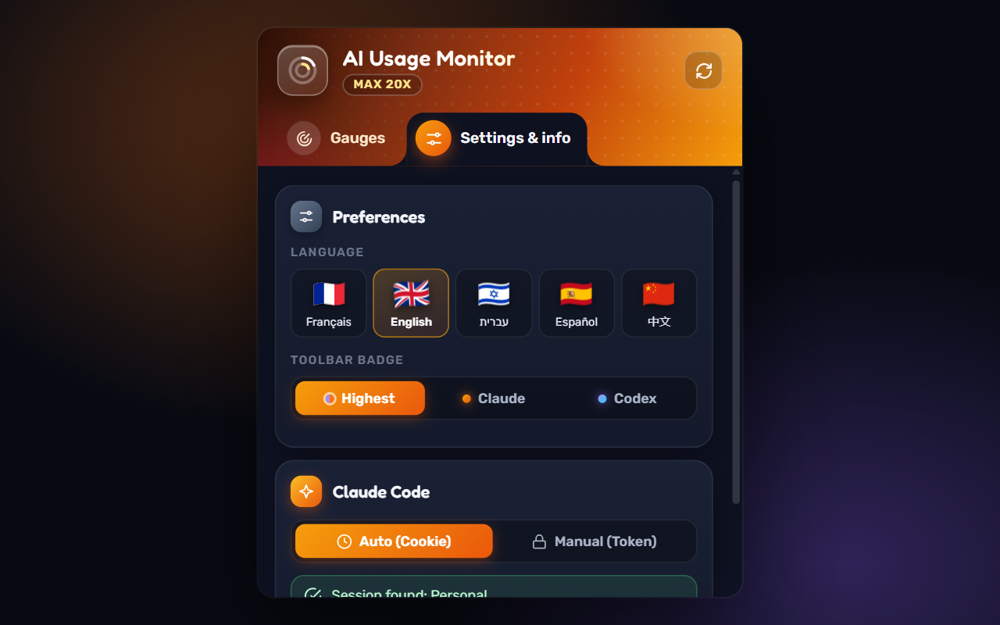

# AI Usage Monitor – Claude Code & Codex

<div align="center">

**🌐 Language / Langue / Idioma / 语言 / שפה**

[](README.md)
[](docs/README.fr.md)
[](docs/README.es.md)
[](docs/README.zh.md)
[](docs/README.he.md)

---


**Your Claude Code and Codex quotas, side by side, in one click**

[Quick Start](#quick-start) • [Installation](#installation) • [Features](#features) • [Troubleshooting](#troubleshooting)





</div>

---

## What's new in 5.0

- **Codex support**: your ChatGPT plan's Codex limits (read from `chatgpt.com/backend-api/wham/usage`, using your chatgpt.com session or a pasted `~/.codex/auth.json`).
- **Three gauges side by side**: Claude Code 5 hours and 7 days in one card, Codex next to it.
- **New design** with two tabs: *Gauges* (default) and *Settings & info* (language, toolbar badge, Claude and Codex connection).
- **Toolbar badge** shows the highest of the two, or Claude only, or Codex only.
- **Alerts per tool** at 70%, 80%, 90% and 95%.
- Extra bars when your plan has them: Sonnet / Opus weekly limits, Codex code review.

---

## Overview

Claude Usage Monitor is a Chrome extension that displays your Claude API usage in real-time. Track your 5-hour and 7-day rate limits at a glance, receive alerts before hitting your quota, and never be caught off guard.

**Perfect for Claude Code and Claude Max users.**

## Quick Start

1. **Download** the [latest release ZIP](https://github.com/showf68/claude-usage-monitor/releases/latest)
2. **Extract** the ZIP file
3. **Open** `chrome://extensions/` and enable Developer Mode
4. **Click** "Load unpacked" and select the extracted folder
5. **That's it!** If you're already logged in to claude.ai, the extension auto-detects your session instantly! ✨

No configuration needed if you're already logged in to Claude!

## Features

| Feature | Description |
|---------|-------------|
| **Real-time Tracking** | Monitor 5-hour and 7-day usage quotas |
| **Visual Progress** | Beautiful circular progress indicators |
| **Color Coding** | Green (< 50%), Orange (50-80%), Red (> 80%) |
| **Smart Alerts** | Notifications at 70%, 80%, 90%, 95% usage |
| **Auto-refresh** | Updates every minute automatically + smart login detection |
| **Cookie Auth** | Auto-detect claude.ai session on install - zero config! |
| **Token Auth** | Manual setup with credentials.json |
| **Multi-language** | English, French, Spanish, Chinese, Hebrew |
| **Auto-detect Language** | Detects browser language automatically |
| **Dark Theme** | Modern UI designed for developers |
| **Privacy First** | All data stays local, no external servers |

## Installation

### Option 1: Download ZIP (Recommended)

1. Download [`claude-usage-monitor-v4.5.zip`](https://github.com/showf68/claude-usage-monitor/releases/latest)
2. Extract the ZIP to a folder
3. Open Chrome and go to `chrome://extensions/`
4. Enable **Developer Mode** (top-right toggle)
5. Click **"Load unpacked"**
6. Select the extracted folder

### Option 2: Clone Repository

```bash
git clone https://github.com/showf68/claude-usage-monitor.git
cd claude-usage-monitor
```

Then load the `claude-usage-monitor` folder directly in Chrome (the extension files are at the root).

## Configuration

The extension supports **two authentication methods**:

### Option A: Auto Mode (Cookie) - Recommended

**Zero configuration needed!** If you're already logged in to [claude.ai](https://claude.ai) in Chrome, the extension automatically detects your session on first install.

**If not logged in yet:**
1. Click the extension icon
2. Click **🔗 "Login to Claude.ai"** button
3. Log in to your Claude account
4. **That's it!** The extension automatically detects your connection within seconds

No tokens or files needed. The extension monitors your session every 2 seconds until connected.

### Option B: Manual Mode (Token)

Use this if cookie mode doesn't work or you prefer explicit token control.

#### Step 1: Find Your Credentials

| Platform | Path |
|----------|------|
| **Windows** | `%USERPROFILE%\.claude\.credentials.json` |
| **macOS** | `~/.claude/.credentials.json` |
| **Linux** | `~/.claude/.credentials.json` |

#### Step 2: Copy & Paste

1. Open the credentials file in any text editor
2. **Select All** (Ctrl+A / Cmd+A)
3. **Copy** (Ctrl+C / Cmd+C)
4. Click the extension icon → Settings → **"Manual (Token)"** tab
5. **Paste** the entire JSON content
6. Click **"Save & Connect"**

#### Credentials Format

```json
{
  "claudeAiOauth": {
    "accessToken": "sk-ant-oat01-...",
    "refreshToken": "sk-ant-ort01-...",
    "subscriptionType": "max"
  }
}
```

## Usage

### Toolbar Badge

The badge shows your current 5-hour usage percentage:

| Badge | Color | Status |
|-------|-------|--------|
| `25` | 🟢 Green | Low usage - plenty remaining |
| `65` | 🟠 Orange | Moderate usage |
| `90` | 🔴 Red | High usage - slow down! |
| `CFG` | 🟡 Yellow | Configuration needed |
| `ERR` | 🔴 Red | Connection error |

### Popup Interface

Click the extension icon to see:
- **5-Hour Usage** - Current window with circular progress
- **7-Day Usage** - Weekly quota tracking
- **Reset Timer** - Time until limits refresh
- **Last Update** - When data was last refreshed

### Notifications

Receive browser alerts at critical thresholds:
- **70%** - First warning
- **80%** - Moderate warning
- **90%** - High usage alert
- **95%** - Critical alert

Alerts reset automatically when usage drops below 50%.

## Troubleshooting

<details>
<summary><b>ERR Badge or "Connection Error"</b></summary>

1. Check your internet connection
2. Verify your token hasn't expired
3. Try reconfiguring with fresh credentials
4. Reload the extension from `chrome://extensions/`
</details>

<details>
<summary><b>CFG Badge</b></summary>

The extension needs configuration:
1. Click the extension icon
2. Paste your `.credentials.json` content
3. Click "Save & Connect"
</details>

<details>
<summary><b>Token Expired</b></summary>

Your access token may have expired. Get fresh credentials:
1. Use Claude Code to refresh your token (any Claude Code command will refresh it)
2. Copy the updated `.credentials.json` content
3. Reconfigure the extension
</details>

<details>
<summary><b>Extension Not Updating</b></summary>

1. Click the refresh button in the popup
2. Check Chrome's extension permissions
3. Ensure the extension has network access
</details>

## Privacy & Security

| Aspect | Details |
|--------|---------|
| **Data Collection** | None - all data stays local |
| **Token Storage** | Chrome's secure storage API |
| **Network Calls** | Only to Anthropic's official APIs |
| **Open Source** | Full code available for audit |

## File Structure

```
claude-usage-monitor/
├── manifest.json          # Extension configuration
├── background.js          # Service worker (API, auth)
├── popup-modern.html      # Popup interface
├── popup-modern.js        # Popup logic
├── icons/
│   ├── icon16.png         # Toolbar icon
│   ├── icon48.png         # Extension icon
│   └── icon128.png        # Store icon
├── _locales/              # Translations
│   ├── en/messages.json   # English
│   ├── fr/messages.json   # French
│   ├── es/messages.json   # Spanish
│   ├── zh/messages.json   # Chinese
│   └── he/messages.json   # Hebrew
├── dist/                  # Packaged releases (ZIPs)
├── docs/                  # Multilingual documentation
│   ├── README.fr.md       # French
│   ├── README.es.md       # Spanish
│   ├── README.zh.md       # Chinese
│   └── README.he.md       # Hebrew
├── LICENSE
└── README.md              # English (main)
```

## Changelog

### v4.5 (Latest)
- **New:** 🎯 Smart auto-detection on first install - automatically detects if you're already logged in to claude.ai (zero configuration!)
- **New:** Auto-refresh after login - automatically detects connection every 2 seconds (no manual refresh needed!)
- **New:** Smart badge display - shows "OK" ✓ for 3 seconds after successful login, then auto-displays usage percentage
- **New:** Version number displayed in footer
- **Fix:** Removed double emoji on login buttons
- **Fix:** Centered login button in error view
- **Improved:** Login check runs in background (survives popup close)

### v4.0
- **New:** Cookie authentication mode - auto-detect claude.ai session
- **New:** Two auth modes: Auto (Cookie) and Manual (Token)
- **New:** Settings tabs to switch between auth modes
- **New:** Session status indicator for cookie mode
- **New:** GitHub link in extension footer
- Simplified setup - just be logged in to claude.ai!

### v3.4
- **Fix:** ZIP package now works correctly on all systems
- Removed CRX (not supported by Chrome policy)

### v3.3
- **New:** Multi-language support (EN, FR, ES, ZH, HE)
- **New:** Auto-detect browser language
- **New:** Language switcher in header
- **New:** RTL support for Hebrew
- Translations stored in `_locales/` folder

### v3.2
- **New:** Paste entire JSON credentials (auto-parsing)
- **New:** Live validation as you type
- **New:** Ready-to-use ZIP package in `/dist`
- Reorganized file structure (icons in folder)
- Compact settings modal (no scrolling)
- Better error messages with debugging info

### v3.1
- Improved error handling
- Detailed debug messages
- Reconfigure button in error view

### v3.0
- Modern dark theme UI
- Dual authentication support
- Circular progress indicators

### v2.x
- Basic usage monitoring
- Token-based authentication

## Contributing

**This project is open to everyone!** We warmly welcome contributions from the community.

Contributions are welcome! Here's how to participate:

1. Fork the repository
2. Create a feature branch (`git checkout -b feature/amazing`)
3. Commit your changes
4. Push to the branch
5. Open a Pull Request

**Contribution ideas:**
- New features
- Bug fixes
- UI improvements
- New translations
- Documentation

## License

MIT License - see [LICENSE](LICENSE) for details.

---

<div align="center">

**Built for the Claude developer community**

If this extension helps you, consider giving it a ⭐

[Report Bug](https://github.com/showf68/claude-usage-monitor/issues) • [Request Feature](https://github.com/showf68/claude-usage-monitor/issues)

</div>
